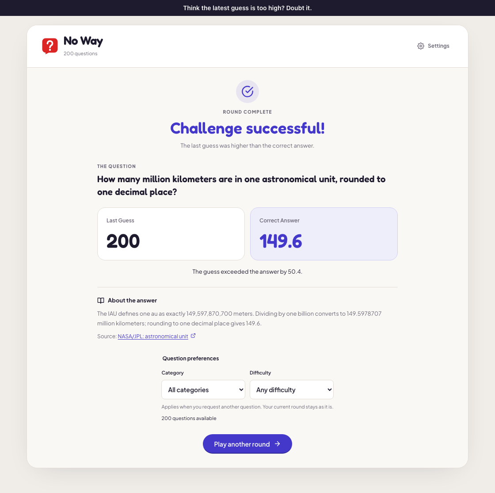
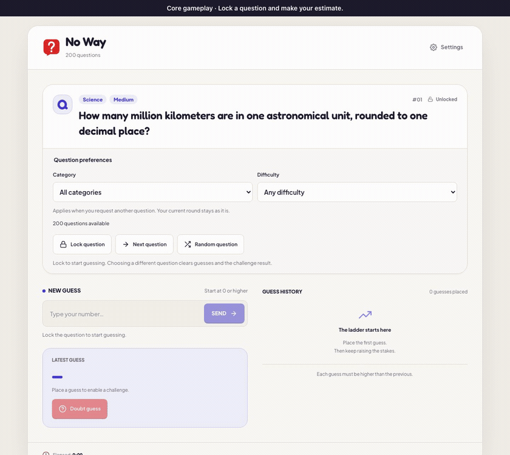
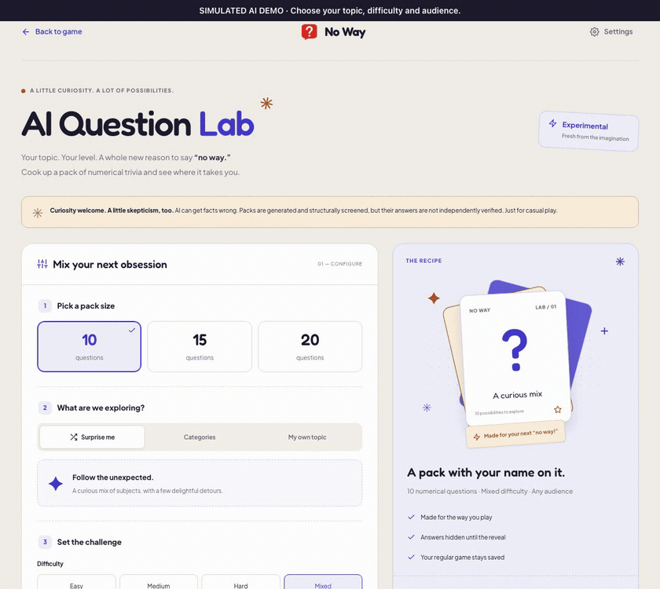
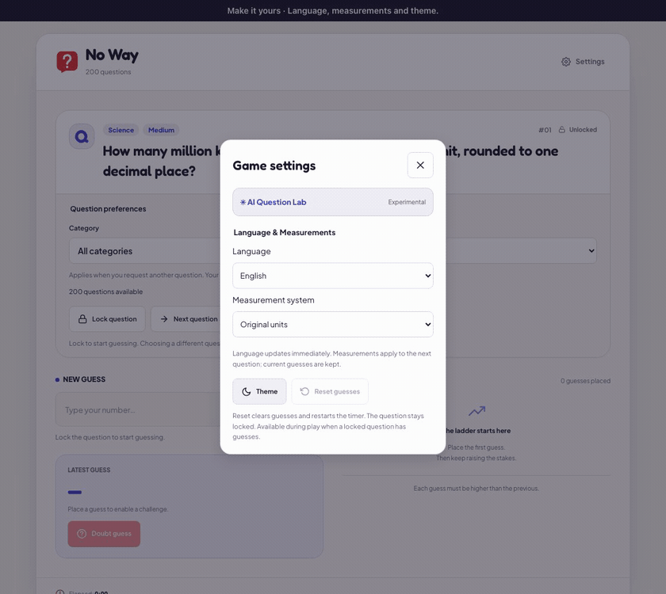
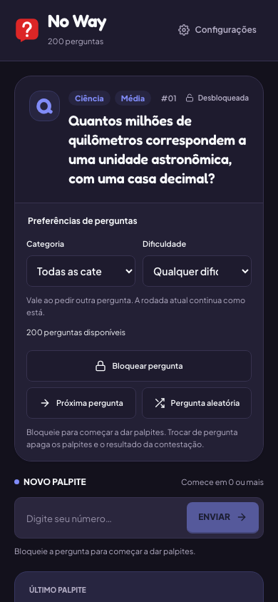

# No Way!

**How high can a guess go before you say “no way”?**

A shared-screen numerical trivia game: take turns raising the guess, challenge it
when it sounds too high, and discover the answer together.

**[Play Live →](https://no-way.paxeri.dev)** · [Source code](https://github.com/lucaspasseri/no-way)

[](https://no-way.paxeri.dev)

## What is No Way!?

How far away is the Moon? How many keys are on a piano? You don't need to know the
exact answer—just decide whether the next guess is still believable.

1. **Pick a question and lock it.** The answer stays hidden.
2. **Make a guess, then raise it.** Every new guess must be higher than the last.
3. **Doubt the latest guess.** If it exceeds the answer, the challenge succeeds
   and reveals the result. An equal or lower guess stays valid, so play continues.
4. **Discover the answer and play another round.** See the numerical comparison
   and available explanation or reference.

Play together around one screen, or explore the questions on your own. The app
doesn't manage online rooms, player accounts or scores.

## See it in action

### Make a guess. Raise the stakes. Doubt it.



### Follow your curiosity in AI Lab

Choose a topic, difficulty and audience, then play a custom question pack.

**Simulated AI generation demo:** this recording uses deterministic local fixtures
in place of an AI provider. It shows the real configuration, screening, pack
summary and gameplay UI; these responses did **not** come from a live model.



AI Lab is experimental. Generated answers are unverified, and live generation
depends on provider availability and quota. If generation stops early, accepted
questions can still be played. Returning to the Lab preserves the saved summary;
generating another batch always requires an explicit action.

### Make it yours

Switch between English and Brazilian Portuguese, select original or metric units,
and choose light or dark mode. Filter classic questions by category and difficulty.



<details>
<summary>Prefer still images? View the Lab, settings and mobile interface.</summary>

[AI Lab gameplay — simulated generation](docs/assets/demos/ai-lab.png) ·
[Customized desktop interface](docs/assets/demos/customization.png)



</details>

## Key features

- **Numerical trivia with a twist:** keep raising the guess until someone doubts it.
- **A curated question collection:** the versioned dataset contains 200 questions,
  with explanations and references where available.
- **Your choice of questions:** browse sequentially, pick randomly, or filter by
  category and difficulty.
- **Experimental custom packs:** request 10, 15 or 20 questions using categories,
  a custom topic, difficulty and audience preferences.
- **English and Brazilian Portuguese:** localized questions, number entry and
  supported measurement conversions.
- **A flexible interface:** responsive layouts, light and dark themes, keyboard
  controls and reduced-motion support.

## Behind the project

The interesting engineering work sits behind a simple guessing loop:

- **Keep answers sealed.** Question selection exposes public fields; challenges
  are checked on the server. Pure game rules reject stale results and preserve
  the current round when requests fail.
- **Treat AI output as input to validate.** Structured schemas and duplicate
  screening sit between generation and play. Bounded recovery, shared cooldowns
  and saved partial packs handle provider failures without silently treating
  generated content as curated fact.
- **Keep content and presentation consistent.** PostgreSQL manages question
  lifecycle and temporary packs. Localization preserves question identity and
  guesses; approved unit conversions use the same rounded answer for display
  and challenge resolution.
- **Verify real flows.** Node's test runner covers rules, APIs and data workflows.
  Playwright exercises gameplay, settings, localization and mocked AI flows.
  These README recordings run against a separate temporary app and database.

## Tech stack

| Technology | Role |
| --- | --- |
| Next.js App Router + React | Server-rendered pages, API routes and interactive gameplay |
| JavaScript + CSS Modules | Game logic, components, responsive styles and shared design tokens |
| PostgreSQL + `pg` | Curated questions, temporary packs and shared provider cooldowns |
| OpenRouter SDK + Zod | Server-side AI integration and structured input/output validation |
| Node test runner + Playwright | Automated checks, browser journeys and repeatable demos |
| FFmpeg | Optimized GIFs from Playwright video recordings |

## Running locally

**Prerequisites:** Node.js 22.15+, npm and a local PostgreSQL database.
No AI key is needed for classic gameplay.

```sh
npm install
cp .env.example .env
# Set DATABASE_URL in .env to your local development database.
npm run db:schema
npm run db:seed
npm run dev
```

Open [localhost:3000](http://localhost:3000). To use live AI generation, configure
your own server-only `OPENROUTER_API_KEY` in the ignored `.env`; never commit it.

```sh
npm test
npm run lint
```

Database upgrades, content curation, provider configuration, integration tests and
build instructions live in the [development and operations guide](docs/development.md).

### Recreate the demos

Install FFmpeg (including `ffprobe`) and local PostgreSQL binaries, then:

```sh
npx playwright install chromium
npm run demos:record
```

This explicit command records three browser videos and converts them into GIFs;
it is separate from ordinary tests. It uses a temporary database, a source copy
and the existing AI fixtures. It does not load `.env` or make live AI requests.
See the [recording guide](docs/demos.md) for prerequisites, isolation and asset checks.

## Project status and links

**Live portfolio project; AI Lab remains experimental.** Classic gameplay and
configuration have automated coverage. This is a shared-screen experience, with
no online multiplayer or persistent player accounts. Generated packs are private
to the browser that created them, expire after 24 hours and remain unverified.

- [Live application](https://no-way.paxeri.dev)
- [GitHub repository](https://github.com/lucaspasseri/no-way)
- [Game architecture, rules and accessibility](docs/game-interface.md)
- [Question service and content workflow](docs/question-service.md)
- [AI Lab architecture and limits](docs/question-lab.md) · [Recovery policy](docs/ai-lab-recovery.md)
- [Localization and measurement handling](docs/localization.md)
- [Design system](docs/design-system.md) · [Dataset audit](docs/question-curation-report.md)
- [Development and operations](docs/development.md) · [Demo recording](docs/demos.md)
